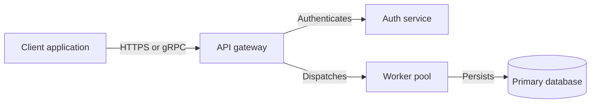

# [Concept or system in sentence case, for example: Storage replication architecture]

[One or two sentences that summarize the concept, its purpose, and the problem it solves for developers.]

## Overview

[Two or three short paragraphs that explain how the system or concept works. Use active voice and present tense, and connect the concept to a concrete developer workflow.]

## Key terms

The following terms name the core components of [System name]:

- **[Term 1]**: [What the component is and what it does.]
- **[Term 2]**: [What the component is and what it does.]
- **[Term 3]**: [What the component is and what it does.]

## How it works

[Explanation of data flow, execution sequence, or mental model.]

### [Stage 1 in sentence case, for example: Ingestion]

[Details of the first stage or component: constraints, data formats, limits.]

### [Stage 2 in sentence case, for example: Processing]

[Details of the second stage or component: error handling, retry policy, scaling behavior.]

## Choose between [Option A] and [Option B]

The following table compares [Option A] and [Option B]:

| Feature | [Option A] | [Option B] |
| :--- | :--- | :--- |
| Consistency model | Strong | Eventual |
| Read latency | Under 10 ms | Under 2 ms |
| Throughput | Up to 10,000 QPS | Up to 100,000 QPS |
| Suits | Financial transactions, inventory | Metrics, telemetry, audit logs |

## Recommendations

When you design a system with [System name]:

- **[Practice 1]**: [What to do and the reason it works.]
- **[Practice 2]**: [What to do and the reason it works.]
- **[Practice 3]**: [What to do and the reason it works.]

## What's next

- For setup steps, see [[Task name]](https://example.com/docs/task).
- For parameter details, see the [API reference](https://example.com/docs/reference).
